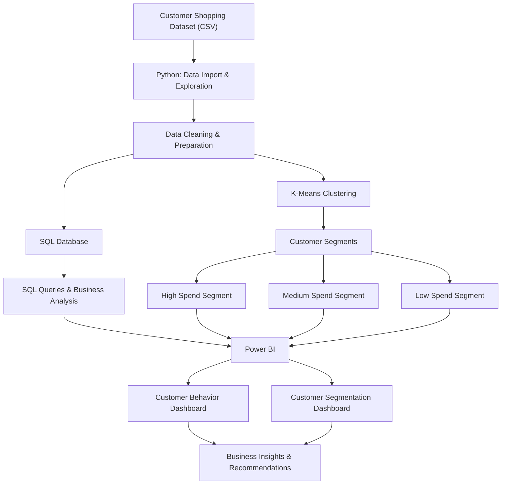
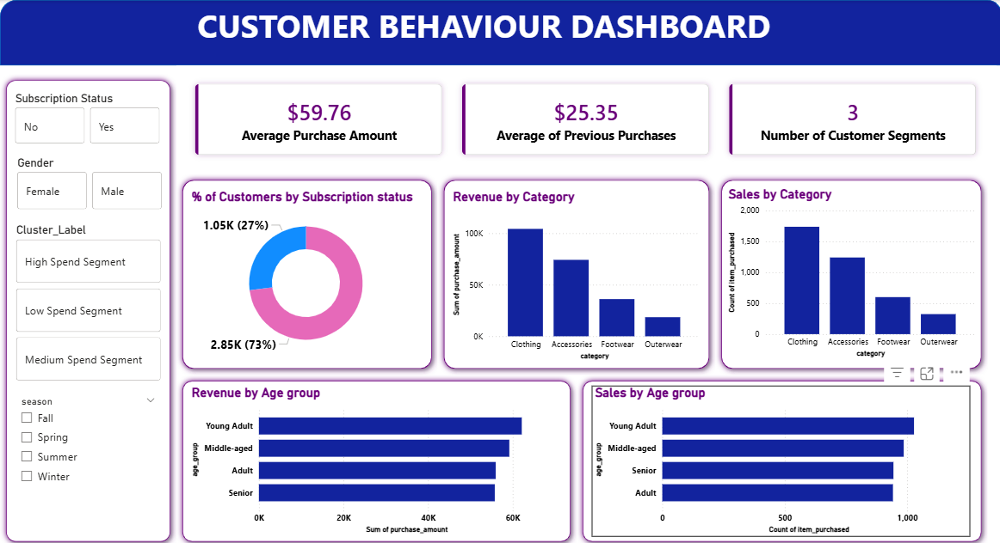
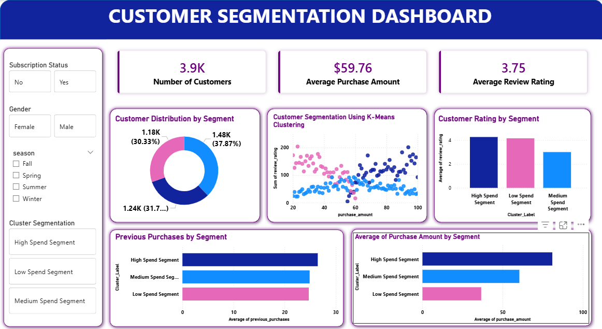

# Customer Shopping Behavior Analysis & Customer Segmentation

An end-to-end data analytics project that explores customer shopping behavior using **Python, SQL, and Power BI**, with an additional **K-Means clustering model** to segment customers based on their purchasing patterns.

This project was independently recreated from scratch, with an additional customer segmentation analysis and an interactive Power BI dashboard to make customer groups easier to understand and act upon.

---

## Table of Contents

- [Project Overview](#project-overview)
- [Problem Statement](#problem-statement)
- [User Pain Points](#user-pain-points)
- [Solution](#solution)
- [Project Workflow](#project-workflow)
- [Customer Segmentation – Project Innovation](#customer-segmentation--project-innovation)
- [Dashboard Highlights](#dashboard-highlights)
- [Key Findings](#key-findings)
- [Business Recommendations](#business-recommendations)
- [Tools and Technologies](#tools-and-technologies)
- [Project Structure](#project-structure)
- [How to Run the Project](#how-to-run-the-project)
- [Outcome](#outcome)

---

## Project Overview

Customer shopping data contains useful information about purchasing habits, product preferences, customer ratings, subscriptions, and spending patterns. However, these details are not always easy to interpret when they are stored in raw datasets.

This project uses Python for data exploration and preparation, SQL for querying and business analysis, and Power BI for interactive visualization. As an additional enhancement, K-Means clustering is used to divide customers into three spending segments: **High Spend, Medium Spend, and Low Spend**. The segmentation dashboard helps visualize the characteristics of these groups and supports more focused business decisions.

## Problem Statement

Businesses collect large amounts of customer shopping data, but identifying meaningful patterns and understanding how different customers behave can be challenging. Without a clear view of customer spending habits, purchase frequency, and satisfaction levels, businesses may struggle to design effective marketing campaigns, improve customer retention, and identify valuable customer groups.

The objective of this project is to analyze customer shopping behavior, extract useful business insights, and apply K-Means clustering to identify distinct customer segments that can support targeted marketing and better business decisions.

## User Pain Points

- **Limited customer visibility:** Businesses may find it difficult to understand the differences between customer spending patterns.
- **Generic marketing campaigns:** Treating all customers alike can result in irrelevant promotions and lower campaign effectiveness.
- **Difficulty identifying valuable customers:** High-spending and repeat customers may not be easily recognized from raw data.
- **Customer retention challenges:** Businesses may lack clear insights into how to encourage low- and medium-spending customers to purchase more frequently.
- **Scattered analytical information:** Important metrics and patterns can be difficult to communicate without a centralized visual dashboard.
- **Limited use of customer feedback:** Customer ratings may not be sufficiently considered when evaluating customer groups and product experience.

## Solution

The project provides an end-to-end analytical solution:

1. **Python – Data Preparation and Exploration:** Load the customer shopping dataset, inspect the data, perform data cleaning, and prepare it for further analysis.
2. **SQL – Business Analysis:** Store and query the prepared data to answer business questions and identify customer shopping trends.
3. **K-Means – Customer Segmentation:** Apply an unsupervised machine learning approach to group customers into three spending segments.
4. **Power BI – Interactive Visualization:** Build dashboards to present customer behavior, segment distribution, spending patterns, and customer ratings.
5. **Business Recommendations:** Translate the analytical findings into practical recommendations for customer engagement and retention.

## Project Workflow

The following diagram represents the end-to-end workflow implemented in this project.



**Workflow summary:** The customer dataset is explored and prepared using Python. The prepared data is used for SQL-based business analysis, while K-Means clustering identifies customer segments. The analytical outputs are visualized in Power BI through customer behavior and customer segmentation dashboards.

## Customer Segmentation – Project Innovation

The key enhancement in this recreation is the addition of **K-Means clustering-based customer segmentation**.

Instead of analyzing customers only as one overall group, the project introduces three customer segments:

- **High Spend Segment:** Customers with comparatively higher purchase amounts.
- **Medium Spend Segment:** Customers with moderate purchase amounts and potential to increase their spending.
- **Low Spend Segment:** Customers with comparatively lower purchase amounts who may respond to suitable engagement strategies.

The clustering results are presented through a dedicated Power BI dashboard. This makes it easier to compare the segments and understand how their purchasing patterns and ratings differ.

> The segment names describe the groups identified in this project. They should not be interpreted as fixed customer identities; clustering results depend on the selected input features and model configuration.

## Dashboard Highlights

### 1. Customer Behavior Dashboard

The customer behavior dashboard provides an overall view of shopping activity through key performance indicators, customer subscription status, revenue by category, sales by category, and age-group comparisons.



### 2. Customer Segmentation Dashboard

The additional dashboard focuses on the customer groups identified using K-Means clustering.

**Dashboard screenshot:**




**Visualizations included:**

- **Customer Distribution by Segment:** Shows the number and percentage of customers in each spending segment.
- **Customer Segmentation Using K-Means Clustering:** Scatter plot showing the distribution of customers using purchase amount and review-rating information.
- **Customer Rating by Segment:** Compares average customer ratings across the three segments.
- **Previous Purchases by Segment:** Compares the average number of previous purchases across customer groups.
- **Average Purchase Amount by Segment:** Highlights differences in average purchase amounts between the segments.
- **Interactive Filters:** Allows users to explore the data using available fields such as subscription status, gender, season, and cluster segmentation.

## Key Findings

Based on the displayed segmentation dashboard:

- The customer base is divided into three spending segments, with each segment representing approximately one-third of the total customers.
- The High Spend Segment has the highest average purchase amount.
- The Medium Spend Segment falls between the high- and low-spending groups in average purchase amount.
- The Low Spend Segment has the lowest average purchase amount.
- The dashboard makes it possible to compare customer ratings and previous purchase behavior across the three segments.
- The clustering scatter plot provides a visual representation of how customers are distributed across the identified groups.

*Note: The dashboard displays approximately 3.9K customers, an average purchase amount of $59.76, and an average review rating of 3.75. These are the overall KPI values shown in the supplied dashboard image.*

## Business Recommendations

- **High-Value Customer Retention:** Provide exclusive rewards, premium offers, and loyalty benefits to retain high-spending customers.
- **Low-Spending Customer Engagement:** Introduce personalized discounts and promotional campaigns to encourage additional purchases.
- **Medium-Spending Customer Growth:** Use bundle offers and relevant product recommendations to encourage customers to increase their spending.
- **Segment-Based Marketing:** Create separate marketing campaigns for High, Medium, and Low Spending Segments.
- **Purchase Frequency Improvement:** Encourage repeat purchases through loyalty points, personalized offers, and seasonal campaigns.
- **Customer Satisfaction Enhancement:** Monitor customer ratings across segments and identify opportunities to improve the shopping experience.
- **Data-Driven Decisions:** Use the clustering results and dashboard insights to plan customer engagement and retention strategies.

## Tools and Technologies

| Tool / Technology | Purpose |
|---|---|
| Python | Data exploration, cleaning, preparation, and clustering implementation |
| Pandas and NumPy | Data manipulation and numerical operations |
| Scikit-learn | K-Means clustering |
| SQL | Data querying and business analysis |
| Power BI | Interactive dashboards and data visualization |
| Jupyter Notebook | Python development and analysis |

*The table lists the technologies used or intended for the documented workflow. Update it if your actual implementation uses a different database, library, or environment.*

## Project Structure

The following is a suggested structure. Update the filenames to match the files in your repository.

```text
Customer-Shopping-Behavior-Analysis/
│
├── dataset/
│   └── customer_shopping_behavior.csv
│
├── notebooks/
│   └── customer_shopping_behavior_analysis.ipynb
│
├── sql/
│   └── customer_behavior_sql_queries.sql
│
├── powerbi/
│   ├── customer_behavior_dashboard.pbix
│   └── customer_segmentation_dashboard.pbix
│
├── images/
│   └── customer_segmentation_dashboard.png
│
├── README.md
└── requirements.txt
```

## How to Run the Project

### 1. Clone the repository

```bash
git clone <your-repository-url>
cd <your-repository-folder>
```

### 2. Set up the Python environment

Install the required libraries based on your implementation.

```bash
pip install pandas numpy matplotlib seaborn scikit-learn jupyter
```

### 3. Explore and prepare the dataset

- Open the Python notebook.
- Import the customer shopping dataset.
- Perform data exploration and data cleaning.
- Prepare the data for SQL analysis and clustering.

### 4. Perform SQL analysis

- Create a database in your preferred SQL database system.
- Load the prepared dataset into the database.
- Execute the SQL queries to analyze customer behavior and shopping trends.

### 5. Perform customer segmentation

- Prepare the required features for clustering.
- Apply the K-Means clustering algorithm.
- Identify and interpret the three customer segments.
- Add the resulting segment labels to the data used for visualization.

### 6. Open the Power BI dashboards

- Open the customer behavior dashboard.
- Open the customer segmentation dashboard.
- Connect or refresh the data source as required.
- Explore the visualizations and interactive filters.

## Outcome

This project demonstrates an end-to-end approach to transforming raw customer shopping data into meaningful business insights using Python, SQL, machine learning, and Power BI.

The additional K-Means clustering implementation extends the analysis from general customer behavior to customer-level segmentation. By identifying High, Medium, and Low Spending Segments and presenting them through a dedicated interactive dashboard, the project provides a clearer understanding of customer purchasing patterns and supports more targeted marketing, customer engagement, and retention strategies.

---


